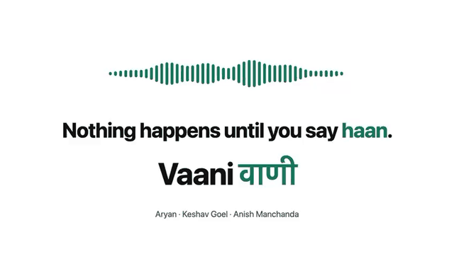
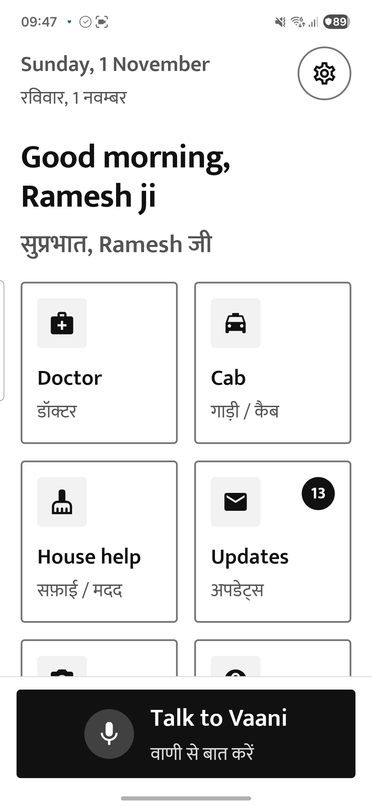
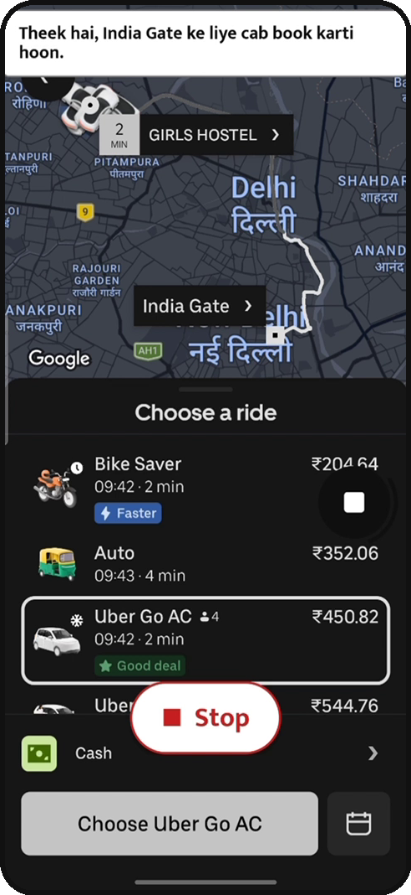
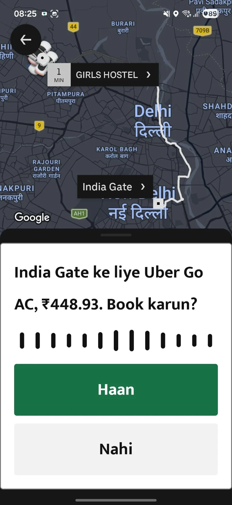
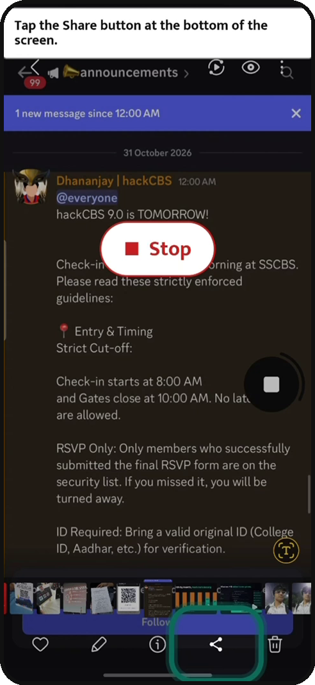
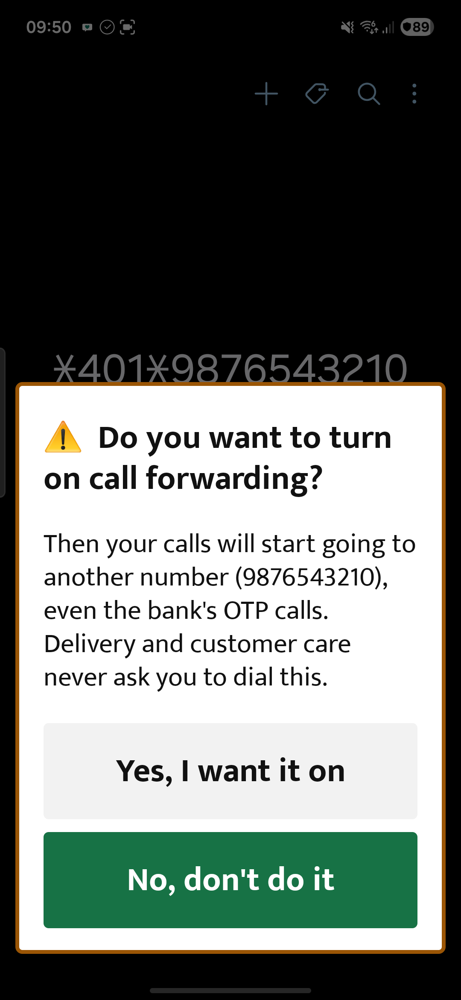
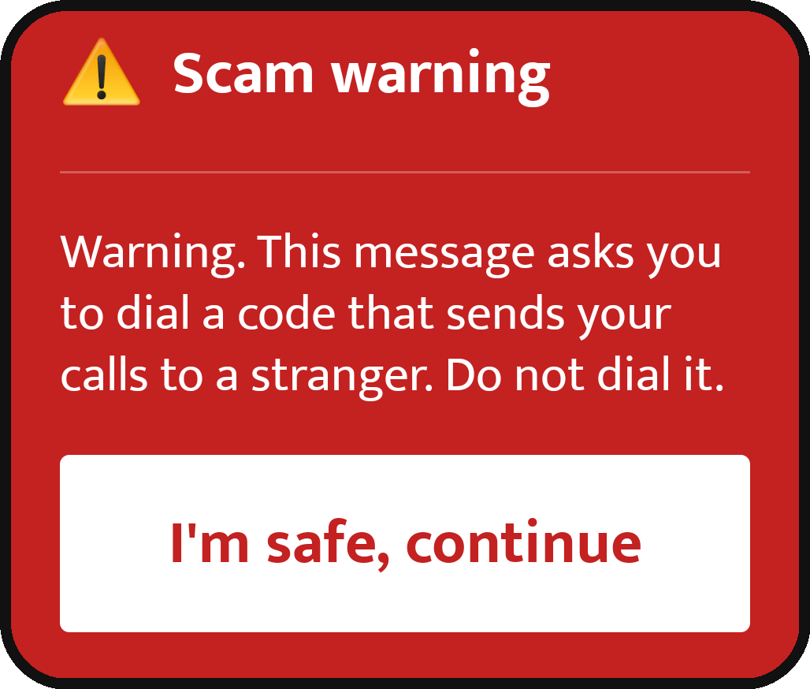
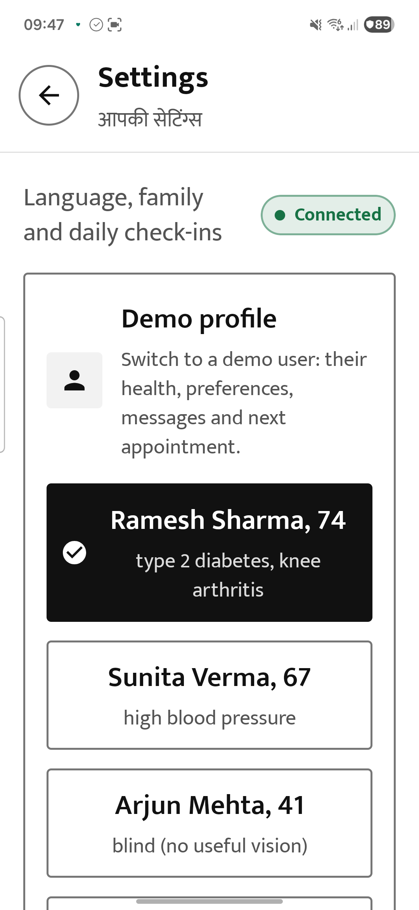
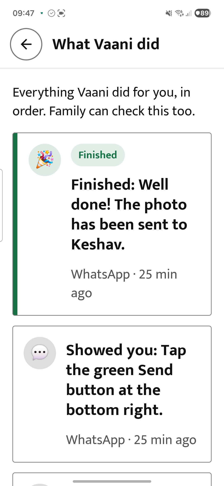
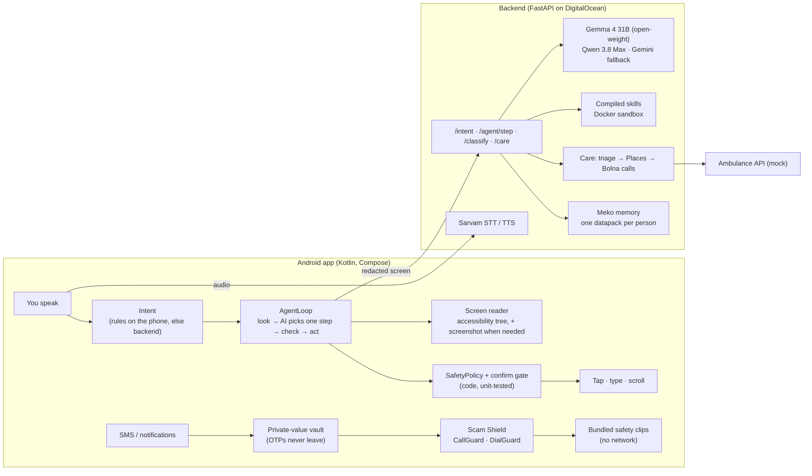

<div align="center">

# Vaani · वाणी

**A voice companion that uses Android for people who find phones hard.**

Speak in Hindi, English or Hinglish. Vaani books the cab, finds and books the doctor by phoning hospitals for you, and
stops scammers. Nothing irreversible happens until you say **“haan”**.

<a href="https://cdn.jsdelivr.net/gh/Aryannnthakurrr/Vaani@master/docs/media/showcase.mp4"></a>

**[▶ Watch the full showcase with sound (1:36)](https://cdn.jsdelivr.net/gh/Aryannnthakurrr/Vaani@master/docs/media/showcase.mp4)** ·
[Download](docs/media/showcase.mp4) · [Slide deck](docs/presentation/Vaani_presentation.pptx) ·
[All documentation](docs/README.md)

</div>

---

## Contents

- [The problem](#the-problem)
- [What Vaani does](#what-vaani-does)
- [Real screens](#real-screens)
- [How it works](#how-it-works)
- [Safety rules enforced in code](#safety-rules-enforced-in-code)
- [How we tested it](#how-we-tested-it)
- [Run it yourself](#run-it-yourself)
- [Configuration](#configuration)
- [Repository layout](#repository-layout)
- [Documentation](#documentation)
- [Known limits](#known-limits)

> The app is called **Vaani** everywhere a person sees or hears it. The code, package (`com.saathi.app`) and some
> documents still use its working name, **Saathi**.

## The problem

Cabs, doctors, bills and bank OTPs now arrive through apps built for young, literate, sighted users. Older people,
blind and low-vision people, and anyone who doesn't read English menus are left to hand their phone, and their OTP, to
whoever is nearby, to go without, or to get scammed.

- 149 million Indians were aged 60+ in 2022 (10.5%); they will be 20.8% of India by 2050 (India Ageing Report 2023,
  UNFPA & IIPS).
- Only 42% of people aged 70+ have smartphone access, and about two in five people over 60 can use the internet (NSS
  telecom survey 2025, analysed by LEAD at Krea University).
- “Digital arrest” scams hit 1,23,672 cases and ₹1,935.51 crore in 2024 (Ministry of Home Affairs, Rajya Sabha,
  March 2025).

## What Vaani does

| | Feature | What it does | Read more |
|---|---|---|---|
| 🚕 | **Uses apps for you** | Books an Uber cab or Pronto house help, or fills an Amazon/Flipkart cart, by reading the screen through Android's accessibility service. It stops for your “haan” before anything final. | [App case studies](docs/features/APP_CASE_STUDIES.md) |
| 👆 | **Shows you how** | Guide mode rings the next button and speaks the step. You tap; Vaani never does. | [App case studies](docs/features/APP_CASE_STUDIES.md) |
| 🩺 | **Doctor and emergency** | A rule-based check catches emergencies on every sentence (siren, countdown, ambulance with live tracking). Otherwise it ranks nearby hospitals on your whole need, phones the top three at once, and books on the same call after your yes. | [Healthcare](docs/features/HEALTHCARE_KT.md) |
| 🧠 | **Remembers you** | One memory per person in Meko, written by seven agents that each record where they learnt a fact. A booked appointment later becomes the destination of “cab to my doctor's appointment”. | [Meko memory](docs/features/MEKO_STATE.md) |
| 🧩 | **Grows personal skills** | Repeated work becomes small, tested code: app routines, request recognisers and per-person abilities (a sugar diary, a BP log, a salt budget, an expense log). The AI still words every reply. | [Compiled code](docs/features/COMPILED_CODE.md) · [Personal abilities](docs/features/PERSONAL_ABILITIES.md) |
| 🛒 | **Shopping camera** | Reads name, MRP and expiry, and warns about sugar or salt for the person holding the phone. | [Personal abilities §4](docs/features/PERSONAL_ABILITIES.md) |
| 🛡️ | **Scam Shield** | Flags call-forwarding codes, APK links and lookalike bank sites. A loud in-call warning plays if an OTP arrives or a payment or screen-sharing app opens during a call with a stranger. | [Privacy pitch](docs/privacy/PRIVACY_PITCH.md) |
| 📬 | **Digest and welfare** | Reads bills, renewals and appointments aloud each morning. If the phone isn't unlocked by noon, family get a Telegram message and can open a read-only family page. | [Spec §7.4–7.5](docs/engineering/SPEC.md) |

Three demo users show how the same app becomes three different assistants: **Ramesh** (74, Hindi, diabetes),
**Sunita** (67, Hinglish, high blood pressure) and **Arjun** (41, English, blind). See
[Personal abilities](docs/features/PERSONAL_ABILITIES.md).

## Real screens

Captured on a phone running the current build; the cab and guide frames come from an unedited run with the real Uber
and WhatsApp apps.

| Home | Vaani picks a car, not the bike | Asks before booking | Guide mode rings the button |
|:---:|:---:|:---:|:---:|
|  |  |  |  |
| **Call-forwarding code typed** | **Scam warning** | **Three demo users** | **What Vaani did (for family)** |
|  |  |  |  |

Older captures from the first UI and four short demo recordings are in [`docs/media/`](docs/media).

## How it works

**The AI suggests. The phone's code decides. You say “haan”.** The model proposes one action at a time; the phone's
`SafetyPolicy` checks it before anything happens, and anything irreversible becomes a spoken yes/no question.



- **Two kinds of apps.** Uber describes its screen well, so Vaani works from text. Pronto hides state changes from
  accessibility, so every Pronto step also sends a screenshot and the AI taps by position. Both run under the same
  rules. ([case studies](docs/features/APP_CASE_STUDIES.md))
- **Models.** Every model ID lives in [`backend/app/models.yaml`](backend/app/models.yaml). Most reasoning runs on
  Gemma 4 31B on DigitalOcean serverless inference; Qwen 3.8 Max compiles skills; Gemini is the fallback and drives
  the live shopping camera; Sarvam Saaras and Bulbul listen and speak. ([learning and models](docs/features/LEARNING.md))
- **Contract.** The app ↔ backend API is specified in [CONTRACTS.md](docs/engineering/CONTRACTS.md).

## Safety rules enforced in code

These are listed in [DEVELOPING.md](docs/engineering/DEVELOPING.md) as rules that must never regress, and each has
tests.

| Rule | Where it is enforced | Tested by |
|---|---|---|
| Book, confirm, pay, order, send and add to cart need a spoken or tapped yes; a direct tap becomes a question | `core/agent/SafetyPolicy.kt`, `AgentLoop.confirmThen` | `SafetyPolicyTest`, `AgentLoopReplayTest` |
| PIN, OTP, CVV, secure and login screens stop the agent; it never types secrets or dial codes | `SafetyPolicy.kt` | `SafetyPolicyTest`, `AgentLoopReplayTest` |
| Acts only in allow-listed apps and opens only deep links built by its own task code | `util/Packages.kt`, `features/tasks` | `TaskLinksTest`, `TaskFixesTest` |
| Guide mode only highlights, asks, finishes or fails | `SafetyPolicy.kt` | `SafetyPolicyTest` |
| OTPs and messages from saved contacts never leave the phone; other private values become tokens | `features/inbox/InboxPipeline.kt`, `PrivateSpans`, `Redactor` | `InboxPrivacyTest`, `PrivateSpansTest`, `RedactorTest`, `PrivacyTest`, `test_privacy.py` |
| Raw message and screen text is never logged | backend logging, `app/routers` | `test_privacy.py`, [privacy audit](docs/privacy/PRIVACY_AUDIT.md) |
| Model-written code runs only after a static check, a fingerprint check and tests, in a sandbox | `backend/app/skills/sandbox.py` | `test_code_skills.py`, `test_skills.py`, `test_abilities.py` |
| Only allow-listed numbers are dialled; 108 is never dialled automatically | `app/telephony`, `app/care/ranking.py` | `test_telephony.py`, `test_bolna.py`, `test_care_dispatch.py` |

Android tests live in [`android/app/src/test`](android/app/src/test/java/com/saathi/app); backend tests in
[`backend/tests`](backend/tests).

## How we tested it

### What each suite checks

| Area | What we wanted to know | Tests |
|---|---|---|
| Agent safety | Does any path tap a commit button without a yes, or act on a secret screen? | Android: `SafetyPolicyTest`, `AgentLoopReplayTest` (replays [recorded screens](fixtures/screens) of Uber, Pronto, Amazon, Flipkart, Practo, WhatsApp and Settings), `TreeSerializerTest`, `TaskLinksTest`, `TaskFixesTest` |
| Scam Shield | Are forwarding codes, bad links and in-call OTP or payment-app risks caught, without flagging genuine bank SMS? | Android: `UssdDetectorTest`, `MessageScannerTest`, `RiskScorerTest`, `UrlExtractorTest`, `LocalLinkRulesTest`; acceptance: `scripts/scam_demo.sh` (four scenarios on the emulator) |
| Privacy | Do secrets stay on the phone, stay out of logs, and is one device kept from another's data? | Android: `RedactorTest`, `PrivateSpansTest`, `InboxPrivacyTest`, `PrivacyTest`, `PrivacyAuditTest`; backend: `test_privacy.py`; measurement: `scripts/privacy_audit.py` → [PRIVACY_AUDIT.md](docs/privacy/PRIVACY_AUDIT.md) |
| Emergency and doctor | Are red flags caught in three languages (with negations)? Is routing right, is ranking driven by the whole need, and is a booking only reported when the transcript proves it? | Backend: `test_care.py`, `test_care_dispatch.py`, `test_care_explicit.py`, `test_care_live_confirm.py`, `test_voice_care.py`, `test_bolna.py`, `test_telephony.py`, `test_calls.py`; Android: `CareReducerTest`, `CountdownWordsTest`, `PatientReplyTest` |
| Compiled skills | Do routines replay on held-out runs, do recognisers reach their precision bar, and does unsafe code get rejected before it runs? | Backend: `test_skills.py`, `test_code_skills.py`, `test_abilities.py` |
| Memory | Is each person's memory separate, does each destination see only what it may, and do Meko outages stay hidden? | Backend: `test_memory.py`, `test_voice_live.py`; Android: `AppointmentStateTest`, `ProfilesTest` |
| Voice and language | Are yes/no answers, silences, language switches, place choices and names understood? | Android: `VoiceRulesTest`, `SpokenAnswerTest`, `LanguageSwitchTest`, `PlaceChoiceTest`, `NameMatcherTest`, `SpeakerSentencesTest`, `LiveVoiceTest`, `VoiceLevelTest`; backend: `test_rules_intent_fixes.py`, `test_romanize.py`, `test_revoice.py`, `test_gemini_speech.py` |
| Inbox, digest, welfare | Are messages classified offline, reminders planned and welfare alerts sent at the right time? | Android: `LocalClassifierTest`, `LocalDigestWriterTest`, `ReminderPlannerTest`, `WelfareRulesTest`, `LocalClinicCallTest`; backend: `test_api.py`, `test_family.py`, `test_units.py` |
| Speed and cost | Does a stalled model get overtaken by its fallback, and is usage metered without guessing prices? | Backend: `test_speed.py`, `test_usage.py`; Android: `UsageMeterTest`; simulation: `scripts/simulate_profiles.py` → [SIMULATION.md](docs/evaluation/SIMULATION.md) |

### Measurements, not claims

| Measurement | How | Result on our test set |
|---|---|---|
| Private values leaving the phone | 12 realistic SMS, email and WhatsApp messages holding 22 private values, run through the real notification path; the outgoing data was searched for each value | None left the phone |
| Personal data in server logs | 32 requests packed with names, numbers and secrets through every route, all logs captured at debug level | None appeared |
| Cross-device access | Forged and cross-device requests against device-owned routes | All 16 rejected |
| AI steps saved by a learned routine | A simulated month of cab rides per demo profile | 38% fewer AI steps |
| Sandbox speed | Compiled code in a fresh Docker container on the server | ~0.55 s per run; a memory bomb was killed in 0.7 s |

Full method and tables: [PRIVACY_AUDIT.md](docs/privacy/PRIVACY_AUDIT.md), [SIMULATION.md](docs/evaluation/SIMULATION.md),
[COMPILED_CODE.md](docs/features/COMPILED_CODE.md). Manual, on-device checks are in
[TESTING.md](docs/engineering/TESTING.md) and the verification logs in [NOTES.md](NOTES.md).

### Latest run (1 November 2026)

| Suite | Command | Result |
|---|---|---|
| Backend | `cd backend && .venv/Scripts/python -m pytest -q` | 293 of 296 pass; 3 failing tests are listed in [NOTES.md](NOTES.md#open-test-failures-2026-11-01) |
| Android unit tests | `cd android && ./gradlew :app:testDebugUnitTest` | 160 of 163 pass; 3 failing tests are listed in [NOTES.md](NOTES.md#open-test-failures-2026-11-01) |

## Run it yourself

Everything works **without API keys**: mock mode replays recorded screens and scripted AI answers.

```bash
bash scripts/backend_dev.sh      # mock backend on :8000
```

```bash
bash scripts/emu_setup.sh        # Android 15 emulator (add -no-window for headless)
```

```bash
bash scripts/dev_install.sh      # build, install, grant every permission
```

```bash
bash scripts/seed_inbox.sh       # demo SMS → morning digest
```

```bash
bash scripts/scam_demo.sh        # the four Scam Shield scenarios
```

```bash
bash scripts/mock_ambulance.sh   # the ambulance dispatch stand-in on :9000
```

- **Typed speech** on debug builds:
  `adb shell am broadcast -a com.saathi.app.DEBUG_SAY --es text "'Saket ke liye cab book kar do'" -p com.saathi.app`
- **Replay mode:** Settings → Developer → Demo replay runs tasks on the recorded screens in `fixtures/screens/`.
- **Demo users:** Settings → Demo profile → Ramesh, Sunita or Arjun.
- **On a real phone:** `adb reverse tcp:8000 tcp:8000`, then Settings → Backend URL `http://localhost:8000`. On
  Android 13+, sideloaded apps need App info → ⋮ → Allow restricted settings before accessibility can be turned on.

Toolchain: JDK 17, Gradle 8.11.1 (wrapper), AGP 8.7.3, Kotlin 2.1.0, compile/target SDK 35, min SDK 29, Python 3.12.
Step-by-step test guide: [TESTING.md](docs/engineering/TESTING.md). Server deployment: [deploy/README.md](deploy/README.md).

## Configuration

Copy `.env.example` to `.env` (git-ignored). **No key ever ships in the APK.**

| Group | Variables | Turns on |
|---|---|---|
| Models | `GEMINI_API_KEY`, `DIGITALOCEAN_INFERENCE_KEY`, `SARVAM_API_KEY` | Real AI answers, vision, speech |
| Doctor and calls | `GOOGLE_MAPS_API_KEY`, `BOLNA_API_KEY`, `BOLNA_INQUIRY_AGENT_ID`, `BOLNA_BOOKING_AGENT_ID`, `BOLNA_TOOL_SECRET`, `CALL_ALLOWED_NUMBERS`, `MASK_HOSPITAL_NUMBERS`, `DEMO_PHONE_MAP` | Hospital search and real phone calls (only to allow-listed numbers) |
| Emergency | `MOCK_AMBULANCE_BASE_URL`, `MOCK_AMBULANCE_API_KEY`, `EMERGENCY_COUNTDOWN_SEC`, `SIM_SPEED_MULTIPLIER` | Ambulance dispatch stand-in |
| Memory and skills | `MEKO_API_KEY`, `SKILL_SANDBOX`, `SKILL_MIN_RUNS`, `SKILL_MIN_SAMPLES`, `SKILL_SHADOW_AGREE`, `SKILL_AUTO_APPROVE` | Meko memory and the compiled-skill loop |
| Family and links | `TELEGRAM_BOT_TOKEN`, `DASHBOARD_SECRET`, `PUBLIC_BASE_URL`, `SAFE_BROWSING_API_KEY`, `SANDBOX_ENABLED` | Family alerts, family page, link checks |

The link sandbox opens untrusted URLs in headless Chromium: run it only inside Docker
(`docker build -f backend/Dockerfile -t saathi-backend .`).

## Repository layout

```
android/          Android app (com.saathi.app): agent loop, safety policy, voice, overlays, Scam Shield, care
backend/          FastAPI backend: models.yaml, prompts, care, skills + sandbox, memory, tests
mock_ambulance/   Ambulance dispatch API stand-in with a driver page
fixtures/         Recorded app screens, scripted agent runs, demo messages, personas and their abilities
scripts/          Emulator, install, demo, audit and simulation scripts
deploy/           DigitalOcean deployment (Docker Compose + Caddy)
docs/             Documentation, media and the slide deck (index: docs/README.md)
NOTES.md          Running log: what was verified, deviations from the spec, open gaps
```

## Documentation

Start at the **[documentation index](docs/README.md)**. The most useful entry points:

| If you want to… | Read |
|---|---|
| Understand how Vaani uses Uber and Pronto | [APP_CASE_STUDIES.md](docs/features/APP_CASE_STUDIES.md) |
| Understand the doctor and emergency features | [HEALTHCARE_KT.md](docs/features/HEALTHCARE_KT.md), then [CARE.md](docs/features/CARE.md) for the API |
| See how repeated work becomes code, and the sandbox | [COMPILED_CODE.md](docs/features/COMPILED_CODE.md), [LEARNING.md](docs/features/LEARNING.md) |
| Meet the three demo users | [PERSONAL_ABILITIES.md](docs/features/PERSONAL_ABILITIES.md) |
| See how memory works across agents | [MEKO_STATE.md](docs/features/MEKO_STATE.md) |
| Judge the privacy story | [PRIVACY_PITCH.md](docs/privacy/PRIVACY_PITCH.md), [PRIVACY_AUDIT.md](docs/privacy/PRIVACY_AUDIT.md) |
| Contribute code | [DEVELOPING.md](docs/engineering/DEVELOPING.md), [CONTRACTS.md](docs/engineering/CONTRACTS.md), [NOTES.md](NOTES.md) |

## Known limits

- Hospital calls in demos ring our own test phone; the ambulance API is a realistic stand-in, since 108 has no public
  API.
- During a task, screen text and screenshots from allowed apps go to a cloud model (never logged, stopped at secure
  screens). An on-phone-only mode is not built yet.
- Coordinate taps on apps like Pronto are not bounds-checked, and the yes gate for them relies on a labelled element
  being under the point.
- The three demo users' abilities are seeded to show the result of the learning loop; they are re-tested in the
  sandbox at every backend start.
- Recorded app screens are hand-built from real apps and drift as the apps change; the agent prompts may need tuning
  on new app versions.

Everything verified, every deviation from the spec and every open gap is logged in [NOTES.md](NOTES.md).

---

Built by **Aryan Thakur, Keshav Goel and Anish Manchanda**.
