# Saathi — an AI companion that operates Android for people who find phones hard

Saathi is an Android app and a small Python backend. You talk to it in **English, Hindi or Hinglish**, and it:

| | Feature | What it does |
|---|---|---|
| 🚕 | **Acts for you** | Books an Uber, house help (Pronto) or a Practo doctor, or adds an item to your Amazon cart, by reading the screen and tapping through the app with an AccessibilityService. **Every booking or payment waits for your spoken "haan".** |
| ❓ | **Shows you how** | Guide mode puts a pulsing ring around the next button and speaks the instruction. You do the tapping, and Saathi never taps in this mode. |
| 🛒 | **Shopping camera** | Point the camera at a pack: it reads the product name, printed MRP and expiry, warns if the pack is expired or close to expiry, and can hand the product to the Amazon task. |
| 📬 | **Morning digest** | Reads bank, bill and delivery messages, masks OTPs, card numbers and Aadhaar numbers on the phone, then speaks a digest and sets reminders. |
| 💛 | **Welfare check** | If the phone hasn't been unlocked by noon, family get a Telegram message. |
| 🛡️ | **Scam Shield** | Flags call-forwarding USSD codes (`*401*`), APK links and lookalike bank sites. If an OTP arrives, or a payment or screen-sharing app opens, **during a call with a stranger**, it plays a loud warning through the earpiece. |

Every feature also works **without API keys**: mock mode replays recorded screens and scripted agent steps.

## Screenshots

These were taken on the Android 15 emulator in mock mode.

| Home | Booking needs your "haan" | Guide mode |
|---|---|---|
| 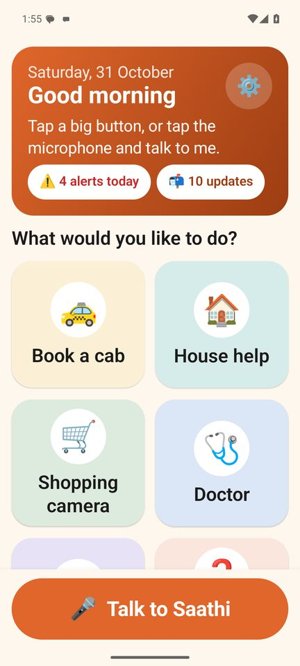 |  | 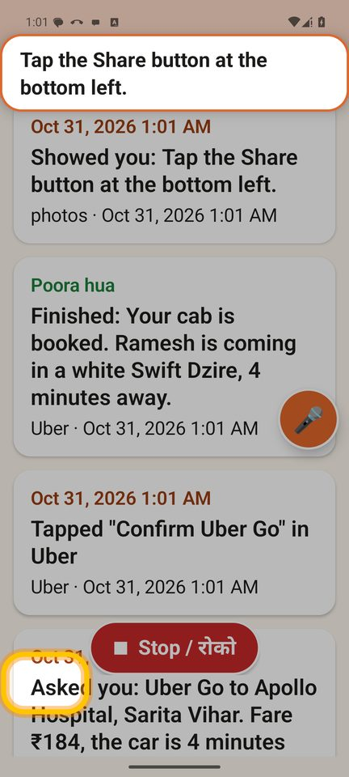 |
| **Scam call + OTP** | **Forwarding-code SMS** | **Shopping camera** |
| 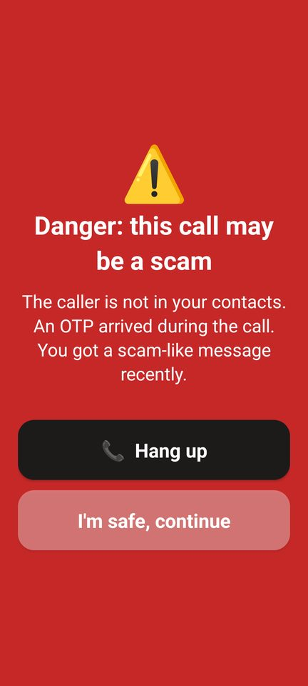 |  | 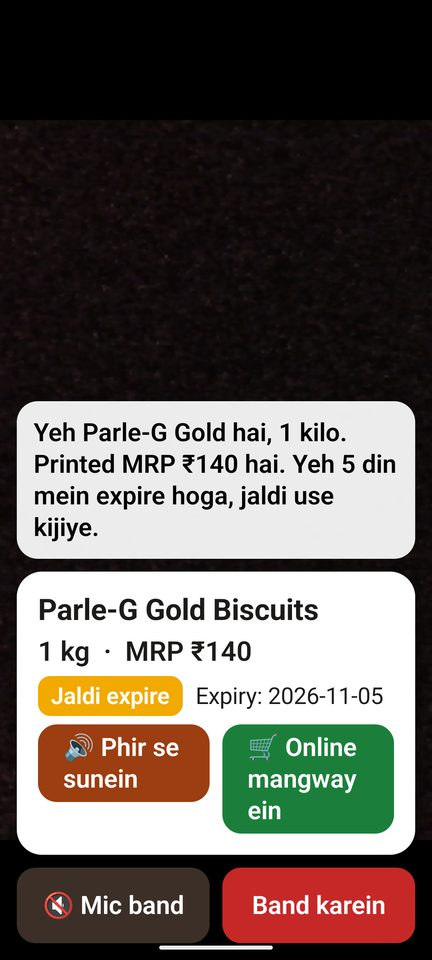 |
| **My updates (digest)** | **Safety alerts** | **Activity log for family** |
|  | 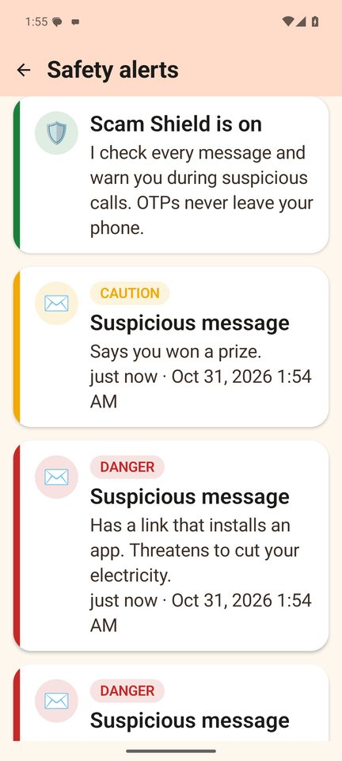 | 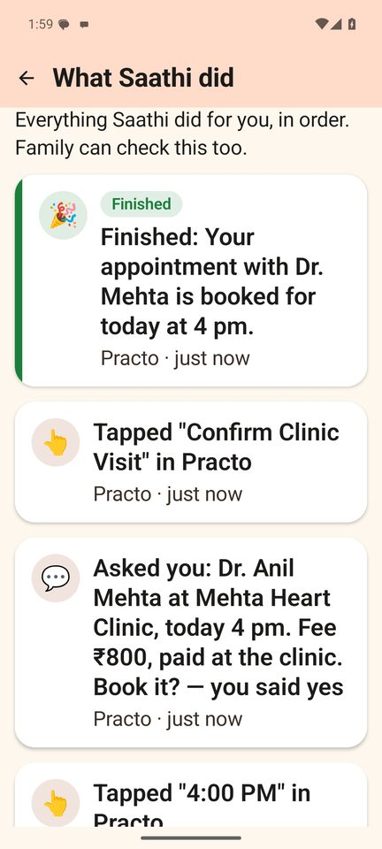 |
| **Answer by typing** | **Welfare test** | **AI call to the clinic (simulated)** |
| 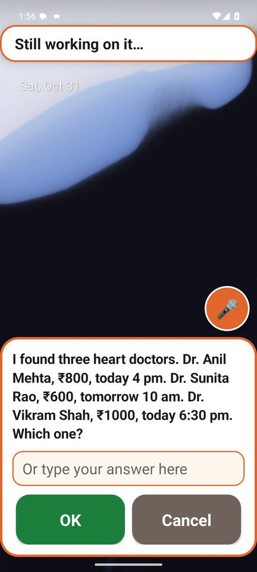 | 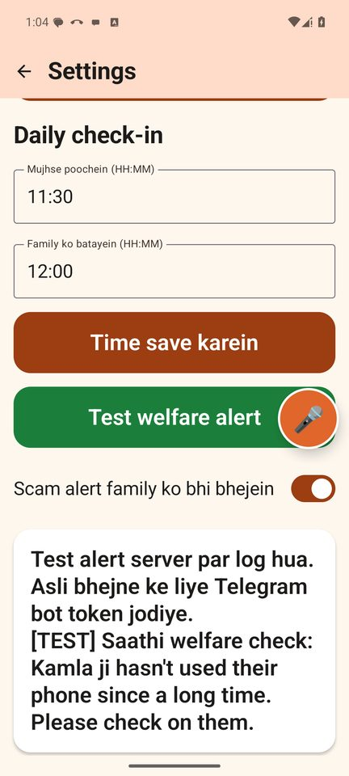 | 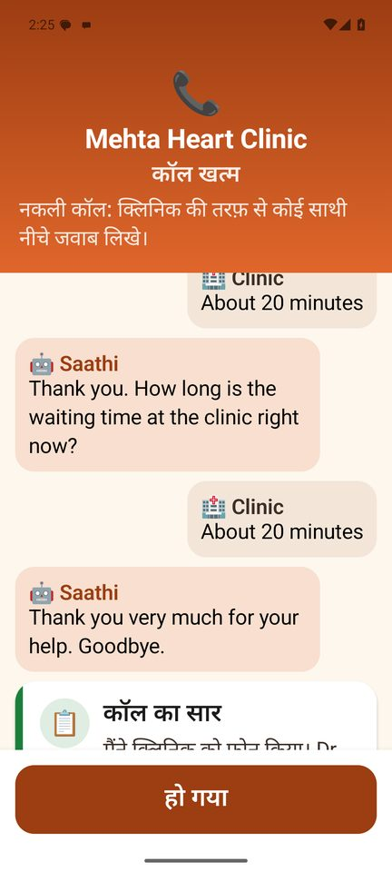 |
| **हिन्दी Home** | **हिन्दी digest** | **Settings** |
| 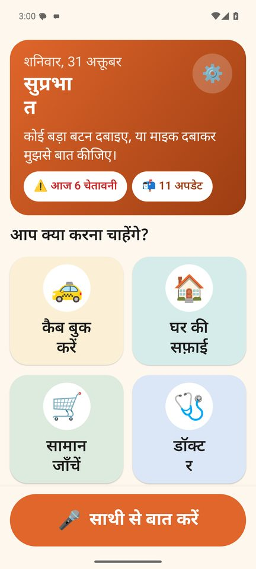 | 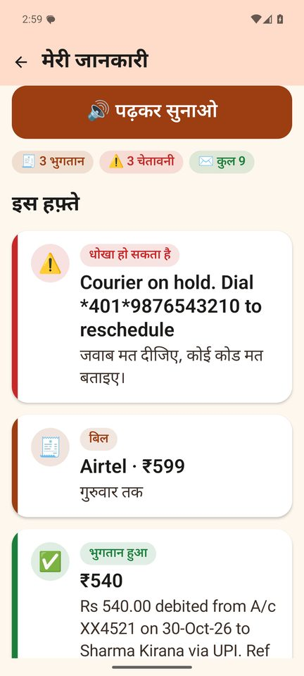 | 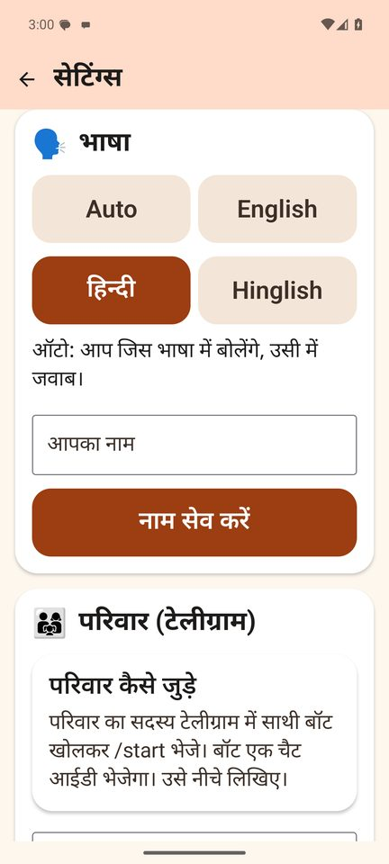 |
| **Dark mode** | **Dark digest** | **Flipkart ("Flipkart se mangao")** |
| 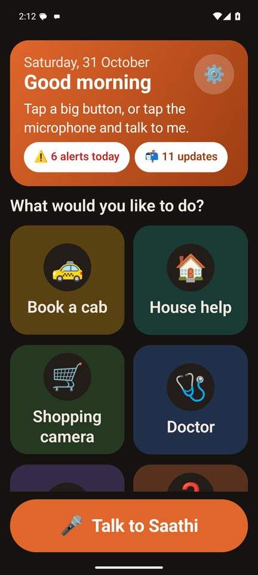 | 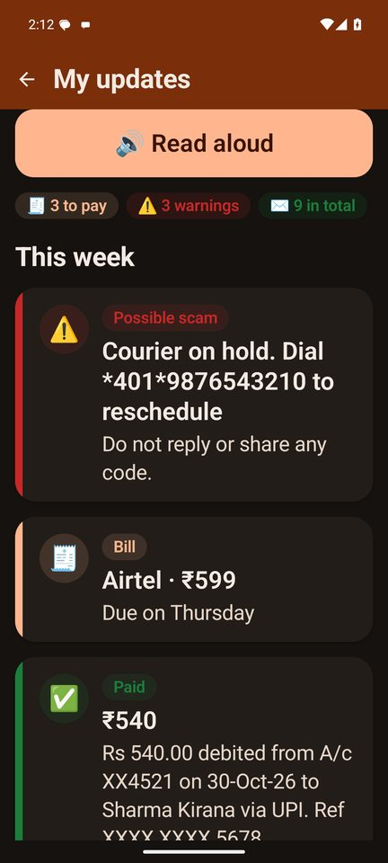 |  |

**Backup demo videos** (SPEC §15) are in [`docs/demo/`](docs/demo):
- `cab_booking.mp4`
- `guide_mode.mp4`
- `shopping_camera.mp4`
- `scam_shield.mp4`

To re-record them, run `bash scripts/record_demos.sh all`.

---

## Quick start (no keys needed)

```bash
# 1. Backend in mock mode
bash scripts/backend_dev.sh            # http://localhost:8000/health → {"mock": true}
```

```bash
# 2. Emulator (API 35, Google Play image)
bash scripts/emu_setup.sh
```

```bash
# 3. Build, install and grant every permission through adb
bash scripts/dev_install.sh
```

```bash
# 4. Demo data
bash scripts/seed_inbox.sh             # ~13 demo SMS: bills, renewal, appointment, OTP, scams
bash scripts/scam_demo.sh              # the four Scam Shield scenarios
```

**Toolchain used to build this repo:** JDK 17 (Temurin), Gradle 8.11.1 through the wrapper, AGP 8.7.3, Kotlin 2.1.0, compileSdk/targetSdk 35, minSdk 29. The backend uses Python 3.12.

Android unit tests:

```bash
cd android && ./gradlew :app:testDebugUnitTest
```

Backend tests:

```bash
cd backend && .venv/Scripts/python -m pytest -q      # (bin/python on macOS/Linux)
```

### Try it without real apps (replay mode)

In the app, go to **Settings → Developer → Demo replay**. Turning it on makes every task and guide flow run against the recorded screens in `fixtures/screens/` (Uber, Amazon, Practo, Pronto, Settings → Font size, and sharing a photo on WhatsApp), using the real agent loop, safety policy, confirm sheet and highlight ring. Settings → **Work offline** also replaces the backend with the on-device `FakeBackendClient`.

### Adding keys later

Copy `.env.example` to `.env` and fill in:

| Key | Turns on |
|---|---|
| `GEMINI_API_KEY` | Real agent steps, vision, classification, link verdicts, Gemini Live camera |
| `SARVAM_API_KEY` | Saaras STT and Bulbul TTS. Then run `python scripts/render_alert_clips.py` to bundle the safety voice clips. |
| `TELEGRAM_BOT_TOKEN` | Real family alerts. Family send `/start` to the bot and get their chat ID back. |
| `SAFE_BROWSING_API_KEY` | An extra check for links |

No key ever goes into the APK. Before a release, run `grep -r "AIza" android/`; it should return nothing.

### On a real phone

1. Run `adb reverse tcp:8000 tcp:8000`, then set **Settings → Backend URL** to `http://localhost:8000`.
2. Follow the in-app setup wizard. It asks for one permission per screen and explains each one aloud.
3. On Android 13+, sideloaded apps need **App info → ⋮ → Allow restricted settings** before the accessibility switch can be turned on. The wizard shows this step and links to the page.

> ⚠️ The link sandbox opens untrusted URLs in headless Chromium. **Run it only inside Docker**:
> `docker build -f backend/Dockerfile -t saathi-backend . && docker run -p 8000:8000 --env-file .env saathi-backend`.
> Never run the sandbox on a developer laptop outside a container. It is off unless `SANDBOX_ENABLED=1`.

---

## Architecture

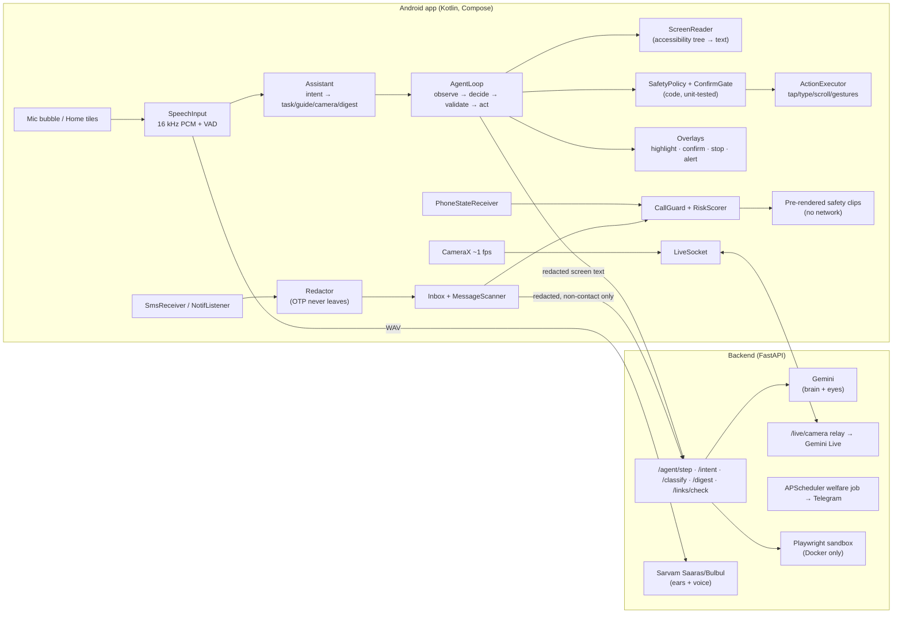

**Design rules enforced in code** (see `core/agent/SafetyPolicy.kt` and its tests):

- **Confirm gate.** A tap on anything labelled book, confirm, pay, place order, buy now, send, request, schedule or add to cart (and the Hindi equivalents) runs only after the user says or taps yes. If the model taps such a button directly, the gate turns the tap into a yes/no question.
- **PIN, OTP, CVV and secure screens** stop the agent, and Saathi asks the user to type the code themselves. **Login screens** are also left to the user.
- **ACT mode** only opens and works in apps on the allowlist. It only opens deep links that Saathi's own task code built, never `tel:`/`sms:` links or dial codes.
- **GUIDE mode** can only highlight, ask, finish or fail.
- Screen and message text is treated as **data**: prompts say so, and the code checks above hold even when the model is fooled.
- **OTP messages and messages from saved contacts never leave the phone.** The activity log stores what was done and why, never raw screen text.

## Repository layout

```
android/   Android Studio project (com.saathi.app)
backend/   FastAPI app, prompts, models.yaml (every model ID lives here), tests, Dockerfile
fixtures/  screens/ (recorded accessibility trees), agent_scripts/ (mock agent), messages/ (demo SMS)
scripts/   emu_setup, dev_install, seed_inbox, scam_demo, backend_dev, render_alert_clips, gen_fixtures
docs/      CONTRACTS.md — the shared app ↔ backend contract
NOTES.md   decisions, verified IDs, deviations and known gaps
```

## Demo script (about 5 minutes)

1. **Hook.** "My grandmother can't book a cab, and last month someone tried to steal her OTP."
2. **Guide mode.** Say "Mujhe ye photo Aarav ko bhejni hai." Pulsing rings walk through sharing the photo, then Saathi says "Well done!"
3. **Shopping camera.** Show a biscuit pack. Saathi reads the MRP, warns that it expires soon, and **Order online** adds it to the Amazon cart.
4. **Cab.** Say "Apollo Hospital jaana hai." Saathi reads the fare and waits for "haan".
5. **Scam Shield.** Run `scripts/scam_demo.sh`: a forwarding-code SMS triggers a red alert, then an unknown caller plus an OTP triggers a spoken in-call warning.
6. **Digest and welfare.** The morning digest is spoken, then **Settings → Test welfare alert** sends the family message.
7. **Close.** OTPs never leave the phone, and every payment needs a spoken yes.

## Limitations (hackathon build)

- The backend uses a shared `X-Saathi-Device` header instead of real authentication. Production needs proper auth.
- Real Uber, Practo and Amazon screens differ from the recorded fixtures, so the prompts may need tuning on real devices. Use the debug **Record screen** button to capture new fixtures.
- On Android 14+, the mic in a background service is restricted. Saathi switches its foreground service to the `microphone` type while listening and falls back to on-device recognition if that is refused.
- `TelecomManager.endCall()` can be blocked on some OEM builds. If so, Saathi says "Press the red button to end the call."
- The AI call to the clinic (stretch, Phase 8) is a **simulated call**: Saathi speaks its side and a teammate types the clinic's replies (Digest → "📞 Call the clinic for me"). Real telephony through Sarvam Samvaad or Exotel is not wired up.

## Family dashboard (stretch)

The backend serves a read-only page for family at `GET /family/<device_id>?key=<key>`. It shows when the phone was last used, the daily check time, family names and recent welfare and scam alerts. Each device's key is an HMAC signed with `DASHBOARD_SECRET`.

The Android app gets the link back from `POST /welfare/config`. When `PUBLIC_BASE_URL` is set, Telegram alerts and the bot's `/start` reply include the link too. The page never shows chat IDs, OTPs or message contents.

See [NOTES.md](NOTES.md) for everything verified and not verified.
